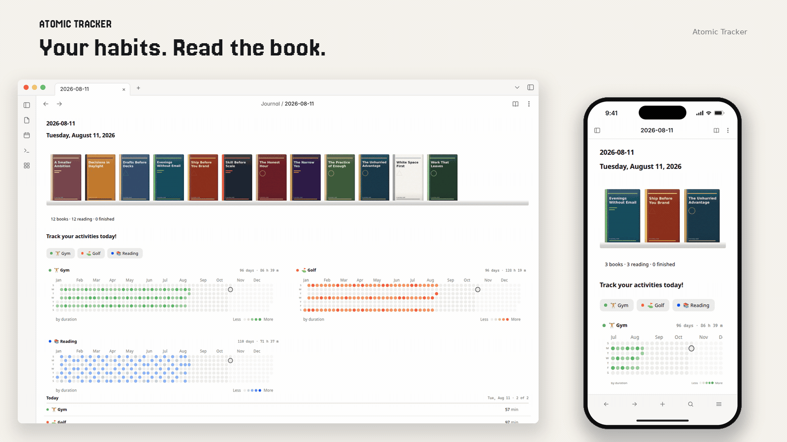
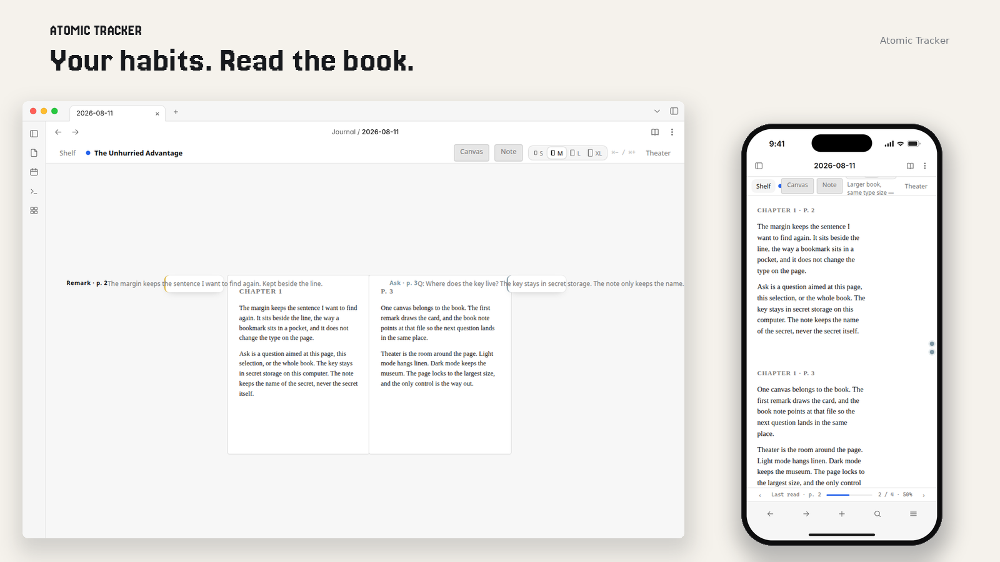
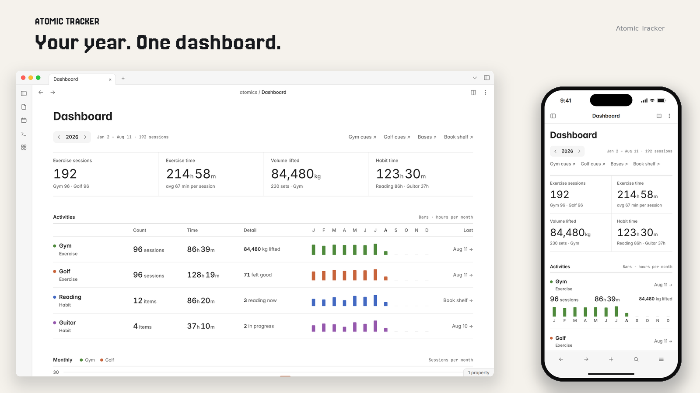
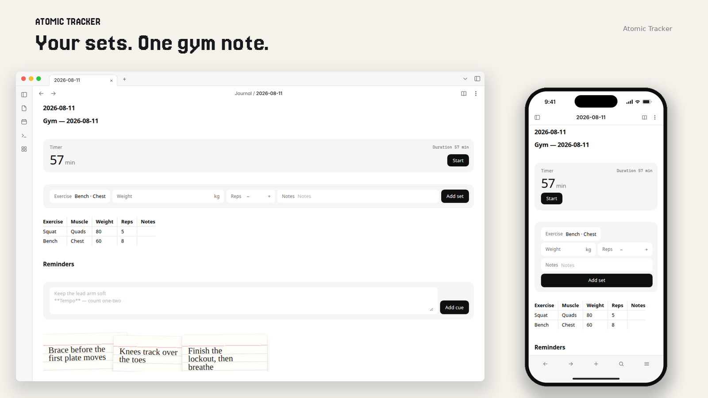
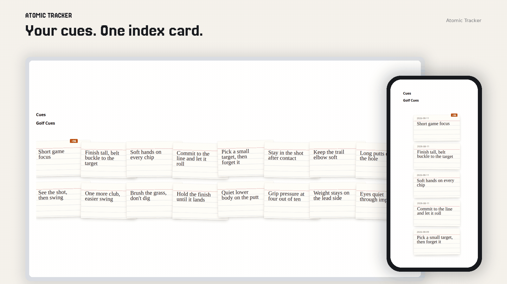

# Atomic Tracker

Habit tracking in Obsidian. Sessions, reading, heatmaps, one daily note.

**Guide:** [docs/USER_GUIDE.md](docs/USER_GUIDE.md)

**Install:** Community plugins (when listed), or copy `main.js`, `manifest.json`, and `styles.css` from the [latest GitHub Release](https://github.com/justinw0ng/obsidian-atomic/releases/latest) into `.obsidian/plugins/atomic-tracker/`. Do not use “Source code (zip)”. After an update, Atomic shows a short What's new notification once. Step-by-step: [user guide](docs/USER_GUIDE.md#install-atomic-tracker).



## Reader

1. Click or tap a cover on the shelf or on a book note.
2. **Open Notes** is the default. It opens the book note.
3. **Open Book** is shown only when that title has an EPUB or PDF. It opens the settled Reading View on that XL page. A computer shows the spread. A phone shows one page when the settled reader is one column. There is no open animation.
4. Theater matches the theme: light linen, or a dark museum. The page stays XL, and it is 500px tall. Exit fades after 2 seconds. Move the pointer or tap to bring it back. Exit or Esc leaves. On a phone the page is a card, and Exit sits at the top of the theater frame.
5. The page is fixed at XL (22 lines). There is no size control and no shortcut. There is no S·M·L·XL choice. The type stays Literata.
6. Ask is titled **Ask · BYO key**. The key stays in Obsidian SecretStorage. Settings store the secret’s name only. The key is not written into `data.json`. That needs Obsidian 1.11.4 or newer. On an older Obsidian, Ask is off and settings tell you to update.
7. Each book has one `.canvas`, opened in Obsidian’s canvas view. The board is Opening, Quote, Ask thread, Characters, and Themes. The book note stores that path as `related_canvas`. Pages use Literata: 12.5px on 19px lines on a computer, and 15px on 23px lines on a phone.



## Dashboard

1. Open `atomics/Dashboard.md`, or run **Open dashboard**.
2. Step the year. Read one totals row, then one row per habit: count, time, detail, and hours each month. **Last** opens that habit’s latest session.



## Gym log

1. Open a gym session note.
2. Press Start on the session timer.
3. Pick an exercise, enter weight and reps, then click Add set.



## Cue cards

1. Open a cue page, for example `atomics/exercise/Golf/Cues.md`.
2. Hover a card to lift it. Click it, or tap it on a phone, to enlarge it in the center.
3. Add a cue from the form on a session note.



Copy-paste notes: [examples/daily-notes](examples/daily-notes) · [examples/templates](examples/templates) · [examples/dashboard](examples/dashboard)

Command palette: **Create today's daily note** and **Create daily note template**. Paths follow Daily Notes / Templates core settings (Obsidian defaults when unset). Wiring: [examples/README.md](examples/README.md#use-the-daily-note-template).

## What it does

- Exercise sessions and custom habits: enable/disable, one color picker → four heatmap shades
- Gym set log (`atomic-gym-log`): pick an exercise, enter weight and reps, click Add set. You don't type the table row yourself
- Cue log (`atomic-cue-log`): type multiline markdown (English or Traditional Chinese) on a session note and click Add cue; logged cues show as the same index cards as the cue page
- Cue pages (`atomic-cues` with `activity:`): every cue of the year as an index card. Hover lifts the card. Click or tap enlarges it in the center. The card grows with the cue and scrolls if it is taller than the window. A narrow list shows four lines of each cue.
- Exercise date notes (gym, golf, and peers) include a start/stop timer that writes `duration_min`
- Reading items with timers, book shelf, and Bases
- Reader for an EPUB or PDF already in the vault. Open Notes is the default. Open Book opens the settled Reading View. A computer shows the spread. A phone shows one page when the settled reader is one column. There is no open animation. Theater is linen or museum, stays XL at 500px, and hides Exit after 2 seconds. Exit or Esc leaves
- The page is fixed at XL (22 lines). There is no size control and no shortcut. There is no S·M·L·XL choice
- Ask is titled Ask · BYO key. The key is in Obsidian SecretStorage (1.11.4 or newer). Settings store the secret’s name only. The key is not stored in `data.json`. Older Obsidian turns Ask off
- One `.canvas` per book, opened in the native canvas view. The board is Opening, Quote, Ask thread, Characters, and Themes. The book note stores the path as `related_canvas`. Page type is Literata at 12.5/19 on a computer and 15/23 on a phone
- Heatmaps filterable with `activity: …`, optional 2×2 grid (`columns`, `rows`, …)
- Yearly dashboard: one totals row, one row per habit with monthly hour bars, a monthly chart, and recent sessions. Last opens the latest session note, including reading
- Property dropdowns for Reading `status`, golf `felt`/`location`, gym `location`/`weight_unit`. The select is the property value. `location` also allows Custom…
- Book shelf: hover pops a book. Click or tap the cover and choose Open Notes (the default) or Open Book when that title has an EPUB or PDF. A cover image fills the book when its width does not match. On the dashboard, click a recent session row to open that note.

Settings → Atomic Tracker → Language: English (`en`, default) or Traditional Chinese (`zh-Hant-en`). Traditional Chinese shows one language. A stored activity name such as `🏋️ Gym / 健身` shows `🏋️ Gym` in English and `🏋️ 健身` in Traditional Chinese. The dashboard activity row shows both halves, `Gym` then `健身`, and the color dot stands in for the emoji. Changing language never rewrites existing notes. Saved language is kept on existing installs.

## Default vault layout

```text
atomics/
├── Dashboard.md
├── exercise/
│   ├── Gym/
│   │   ├── Cues.md
│   │   └── YYYY/YYYY-MM-DD.md
│   └── Golf/
│       ├── Cues.md
│       └── YYYY/YYYY-MM-DD.md
└── hobbies/
    └── Reading/
        ├── Bookshelf.base
        ├── Book Shelf.md
        ├── Covers/
        └── Items/<Book>.md
```

## Privacy

Atomic Tracker runs locally in your vault. It does not collect telemetry, require an account, or show ads. It does not call home. Habit notes stay on this computer. Ask sends only the passage you choose to the provider you pick, with a key kept in Obsidian SecretStorage on this device. The key is not written into `data.json`, the book note, or the canvas. The only other network fetch is if you set a book `cover` to an `http(s):` URL, which Obsidian loads like any other remote image in a note. It reads and writes notes under `atomics/` and any other vault paths you configure (dashboard, activity folders, book covers).

## License

Licensed under the [Apache License 2.0](LICENSE).
